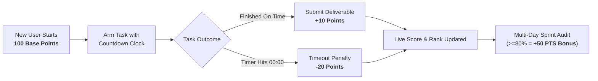

# ⏰ ChronoTask — Gamified Android Task Manager
> **Hybrid Notes + Clock Application for Android with High-Accountability Discipline Scoring, Multi-Day Sprints, and Proof-of-Work Deliverable Submissions.**

---

## 🌟 Executive Overview
**ChronoTask** re-engineers daily productivity for Android operatives by pairing flexible note-taking with strict countdown timers and a gamified accountability score. Every task is armed with a clock; complete it on time and submit proof of what you built to earn points; miss your timer, and suffer an immediate penalty.

---

## 🎮 Core Game Mechanics & Scoring Loop



| Event / Action | Point Impact | In-App Response |
| :--- | :---: | :--- |
| **Account Activation** | `100 PTS` | Baseline discipline tier assigned to all operatives |
| **Punctual Completion** | `+10 PTS` | End-task deliverable submission, tri-tone chime, celebratory confetti |
| **Missed Deadline** | `-20 PTS` | Real-time 1s watcher triggers penalty tone, haptic shake, ledger deduction |
| **Sprint Mastery Bonus** | `+50 PTS` | Awarded on multi-day sprint audit if task completion rate is &ge; 80% |

### 🛡️ Discipline Ranking Tiers
- **Master**: `150+ PTS` — Elite consistency and unyielding execution
- **Punctual**: `100 – 149 PTS` — Solid baseline performance
- **At Risk**: `50 – 99 PTS` — Cautionary status; urgent focus needed
- **Critical**: `< 50 PTS` — Severe penalties incurred; recovery required

---

## ⚡ Key Features

### 1. 🔐 Google 1-Tap & Email Authentication
- **Google OAuth**: Fast 1-tap sign-in with `GoogleAuthProvider` with web popup and redirect fallbacks.
- **Email & Password**: Full registration and sign-in with validation.
- **Profile Card**: Displays user avatar, display name, email, and Cloud Synced indicator.
- **Anonymous Guest**: Instant zero-friction trial without credentials.

### 2. 📝 Notes + Clock Hybrid Tasks
- **Dual-Core Card**: Displays live countdown timer (`HH:MM:SS`) alongside an expandable note sheet for checklists, briefs, and thoughts.
- **Urgency Color Indicators**: Flat OKLCH indicators that shift from subtle blue to amber (<15m) and red (overdue).
- **Audio & Haptic Feedback**: Custom Apple-like sound synthesized with Web Audio API + Capacitor Haptics.

### 3. 📦 Task End Responses ("Submit What Was Made")
- When tapping **"End Task"**, operatives must submit proof-of-work:
  - **Deliverable Summary**: What you created or accomplished.
  - **Output URL (Optional)**: Link to GitHub PR, Figma canvas, Google Doc, Loom, or live demo.
  - **Reflection Notes**: Key execution insights or roadblocks.
- Saved permanently to Firebase Firestore and inspectable under the **"Done"** tab.

### 4. 🗂️ Batch Multi-Task Deployment
- Toggle between **Single Task** and **Batch Multi-Tasks**.
- Quickly add 2, 3, 5, or more tasks with one shared countdown timer (15m, 30m, 1h, 2h, 4h).
- One-click deployment arms all tasks simultaneously.

### 5. 🗓️ Multi-Day Sprint Timers (3, 4, 5 Days) & Report Submission
- Configure multi-day cycles: **3 Days**, **4 Days**, **5 Days**, or 7 Days.
- Live **DD:HH:MM:SS** countdown banner with progress bar.
- **Android Background Push Notification**: When the timer hits 0:
  > *"⏰ Sprint Timer Ended! Submit your report on how many tasks you have done."*
- **Sprint Completion Audit**: Aggregates tasks done vs missed, calculates net score change, records personal reflection notes, and saves the official report to Firebase Firestore (`users/{uid}/sprint_reports`).

---

## 🎨 UI/UX Design System (`qwenton-ui` Standard)
- **Strictly Zero Gradients**: 100% solid, flat OKLCH color science.
- **Dynamic Tokenization**: All derivative states derived programmatically from `--brand-primary: oklch(62% 0.19 250)`.
- **Dark Mode Elevation**: 3 elevated solid surface layers (`16%`, `20%`, `26%` lightness) with glare-free text (`oklch(90% ...)`).
- **Neo-Grotesque Typography**: Built with *Inter*, left-aligned, and scaled dynamically with `clamp()`.
- **Interactive 3D Canvas**: Embedded `@react-three/fiber` 3D watch face with Apple-style studio lighting and live ticking chrono hand.

---

## 🏗️ Technical Architecture & Tech Stack

| Layer | Technologies |
| :--- | :--- |
| **Frontend Framework** | React 18, TypeScript, Vite |
| **3D Graphics** | Three.js, `@react-three/fiber`, `@react-three/drei` |
| **Mobile Runtime** | Capacitor 6 (`@capacitor/android`, `@capacitor/local-notifications`, `@capacitor/haptics`) |
| **Cloud Backend** | Firebase Auth (Google & Email), Cloud Firestore |
| **Design Language** | `qwenton-ui` (Solid OKLCH, Zero Gradients, Inter Typography) |
| **Audio & FX** | Web Audio API Synthesizer, Canvas Confetti |

---

## 📁 Project Directory Structure

```
task manager android/
├── .agent/                         # Persistent AI memory & project living state
│   └── project_state.md            # Living project context file
├── .plan/                          # Multi-phase execution plan
│   └── plan.md                     # Roadmap and completed task checklist
├── android/                        # Native Android Gradle Project (Capacitor)
│   ├── app/
│   │   ├── src/main/AndroidManifest.xml  # Alarm & Notification permissions
│   │   └── google-services.json          # Firebase Android configuration
│   └── build.gradle
├── src/
│   ├── components/                 # React UI Components
│   │   ├── AuthModal.tsx           # Google 1-Tap & Email Auth Modal
│   │   ├── Clock3D.tsx             # Interactive Three.js / R3F 3D Clock Dial
│   │   ├── CreateTaskModal.tsx     # Single & Batch Multi-Task Creator
│   │   ├── EndTaskModal.tsx        # Task End Response (Deliverable Submission)
│   │   ├── ScoreHeader.tsx         # Live Score HUD & Rank Indicator
│   │   ├── ScoreHistoryModal.tsx   # Transaction Audit Ledger
│   │   ├── SprintBanner.tsx        # Multi-Day Sprint Countdown HUD
│   │   ├── SprintReportModal.tsx   # End-of-Cycle Sprint Audit & Report
│   │   ├── StartSprintModal.tsx    # 3, 4, 5 Days Sprint Launcher
│   │   └── TaskCard.tsx            # Dual-View Notes + Clock Task Card
│   ├── context/
│   │   └── TaskContext.tsx         # Gamification Engine & Interval Watcher
│   ├── services/
│   │   ├── firebase.ts             # Firebase Auth & Firestore Client Layer
│   │   └── notifications.ts        # Capacitor Local Notifications & Haptics
│   ├── styles/
│   │   └── theme.css               # qwenton-ui Solid OKLCH Design Tokens
│   ├── types/
│   │   └── index.ts                # TypeScript interfaces & types
│   ├── App.tsx                     # Main Application Controller
│   └── main.tsx                    # React Entrypoint
├── capacitor.config.ts             # Capacitor configuration (App ID: com.qwenton.tasks)
├── google-services (1).json        # Firebase credentials source
├── package.json                    # Project dependencies and npm scripts
├── open_android.bat                # 1-Click Android Studio launch script
├── run_dev.bat                     # 1-Click local development server script
├── prd.txt                         # Product Requirements Document
├── prompt.txt                      # Project prompt documentation
└── README.md                       # Comprehensive project documentation
```

---

## 🚀 Getting Started

### Prerequisites
- [Node.js](https://nodejs.org/) v18 or higher (v24 tested)
- Java OpenJDK 17
- Android Studio (for Android device deployment)

### 1. Local Browser Development
Run the local Vite development server:
```powershell
npm.cmd install
npm.cmd run dev
```
*(Or double-click `run_dev.bat`)*

Open [http://localhost:3000](http://localhost:3000) in your browser.

### 2. Building for Android Native
```powershell
# 1. Compile TypeScript and build production web assets
npm.cmd run build

# 2. Sync web assets and plugins to Android container
npx.cmd cap sync android

# 3. Open project in Android Studio to build APK or run on device
npx.cmd cap open android
```
*(Or double-click `open_android.bat`)*

---

## ☁️ Firebase Configuration

The application is pre-configured with the credentials from `google-services (1).json`:
- **Project ID**: `personal-tasks-5f879`
- **Package Name**: `com.qwenton.tasks`
- **Firestore Collections**:
  - `users/{uid}`: Operative profile and discipline score
  - `users/{uid}/tasks/{taskId}`: Active and completed tasks with deliverable submissions
  - `users/{uid}/history/{logId}`: Score transaction history
  - `users/{uid}/sprint_reports/{reportId}`: End-of-sprint completion reports

---

## 📄 License
MIT License. Built with the **Qwenton** development ecosystem.
